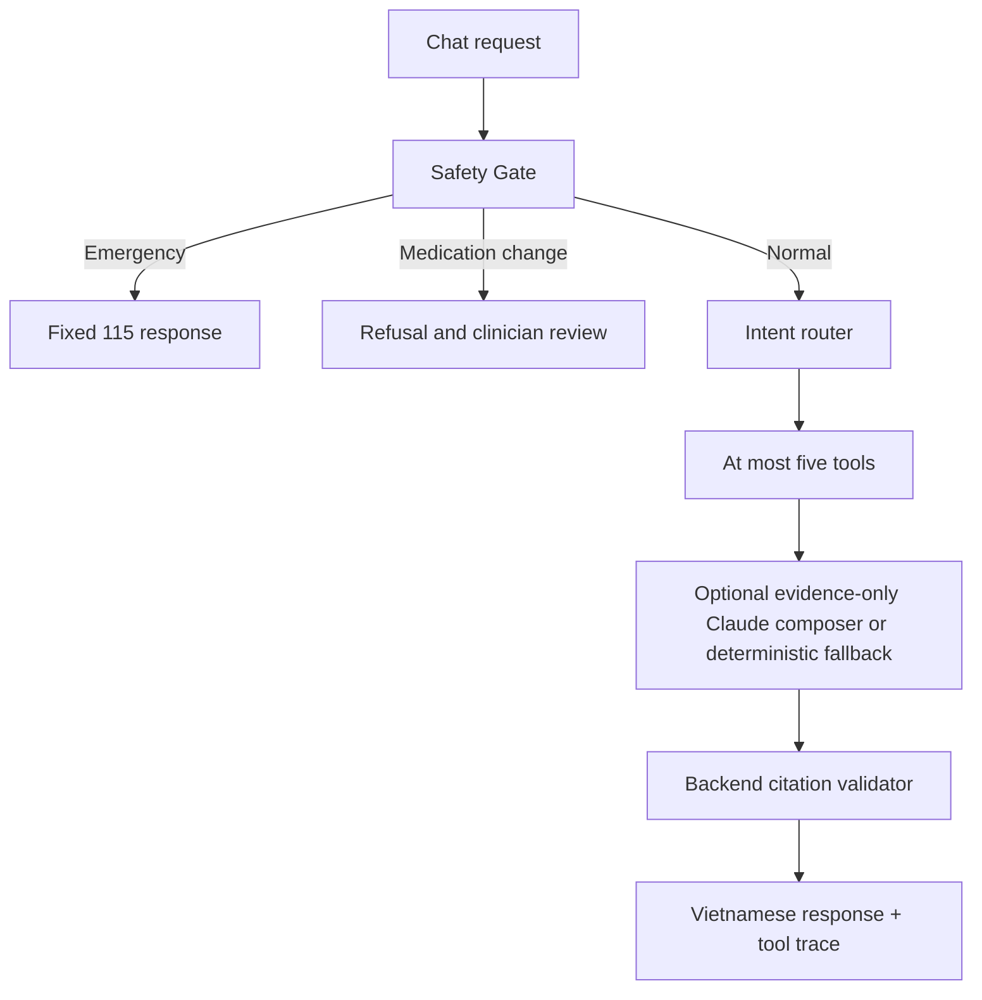

# Agent workflow

Five tools are implemented: `predict_risk`, `classify_lab`, `search_kb`, `get_history`, and `calculate_bmi`. The router supports combinations for lab-plus-KB and risk-plus-history requests. Fusion preserves `ml`, `clinical_rules`, `evidence`, `safety_level`, and `profile_type` as separate fields; model risk is never added to retrieval relevance. The optional Claude composer runs only for KB-only answers and receives approved excerpts, never the user's message or profile/tool data. It is disabled by default and falls back to deterministic extracts. Citation validation is implemented in `backend/app/rag/citations.py`. Unknown or unsupported requests use the approved-only KB path and state when evidence is insufficient.

`session_id` is a request correlation value only; messages and long-term memory are not written to the database. Changing the selected profile resets the browser conversation.
