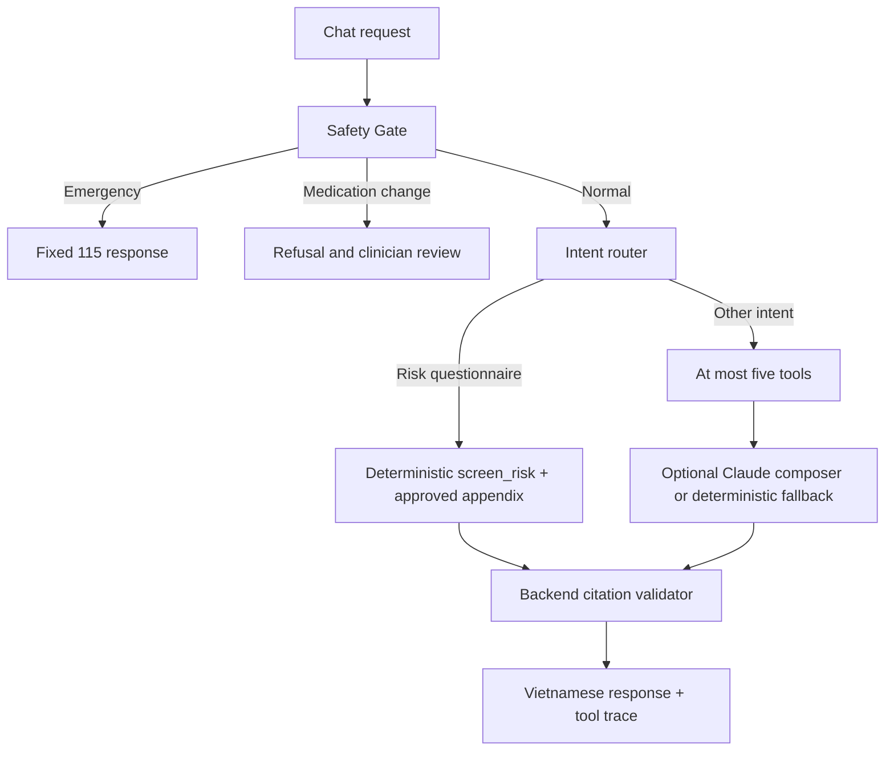

# Agent workflow

Six tools are implemented: `predict_risk`, `classify_lab`, `search_kb`, `get_history`, `calculate_bmi`, and `screen_risk`. The router supports lab-plus-KB and risk-plus-history combinations; personal risk questionnaires use the deterministic `screen_risk` path when the message contains at least two factors or directly asks about the user's risk. That tool reads the approved Appendix 1 chunk `KB-32-c329ac9f-012-0009`, adds a non-diagnosis disclaimer, and bypasses Claude. If the chunk is unavailable, it does not create a citation.

Fusion preserves `ml`, `clinical_rules`, `evidence`, `safety_level`, and `profile_type` as separate fields; model risk is never added to retrieval relevance. The optional Claude composer explains approved KB excerpts for KB-only or combined requests. When enabled, it receives the question after common measurements and identifiers are masked, plus approved excerpts after medication and dose sentences are removed. It does not receive profile data, other tool outputs, lab findings, BMI, risk scores, SHAP values, or history. It is disabled by default; citations and answer checks must pass or the deterministic answer is returned. Safety and medication refusal routes bypass it. Greetings, thanks, usage questions, and requests to interpret a lab result without a value get a fixed reply from `backend/app/agent/guidance.py`, after the Safety Gate and without tools or Claude. Only whole-message matches qualify, so real questions still reach the KB. Unknown or unsupported requests use the approved-only KB path, state when evidence is insufficient, and point the user to the usage guide.

`session_id` is a request correlation value only; messages and long-term memory are not written to the database. Changing the selected profile resets the browser conversation.
