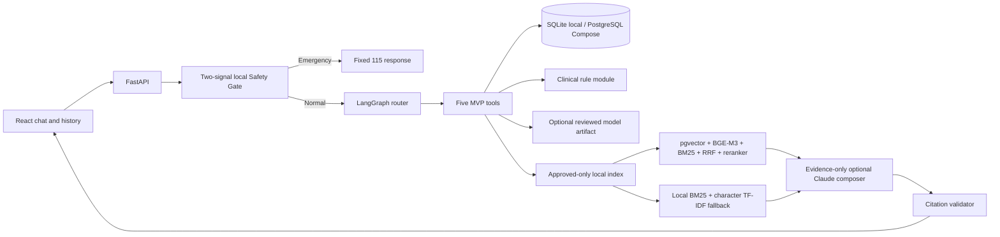

# Architecture and implementation map

## Components

- `backend/app/api`: versioned routes split across `chat.py`, `demo_profiles.py`, `ml.py`, `clinical.py`, and `knowledge.py`; `routes.py` aggregates them without changing endpoint paths.
- `backend/app/agent`: LangGraph state, deterministic intent routing, five tool adapters, structured fusion, and orchestration.
- `backend/app/safety`: accent-insensitive Vietnamese phrase rules plus an independent local character TF-IDF/logistic-regression classifier, medication boundary, timeout handling, and fixed emergency responses.
- `backend/app/clinical`: glucose conversion and reference-only threshold interpretation.
- `backend/app/database`: SQLAlchemy schema, synthetic-only seed, SQLite local default, PostgreSQL Compose option.
- `backend/app/ml`: explicit feature contract, preprocessing, prediction, and explanation modules.
- `backend/app/rag`: source loaders, semantic chunking, approved-only search, citation validation, optional pgvector/BGE-M3/BM25 reciprocal-rank fusion and BGE reranking, with a local BM25/character n-gram TF-IDF fallback.
- `frontend`: React/Vite chat and synthetic history pages, separated components, and a shared API service.
- `ml_training`: reviewed-CSV baseline training and paired no-labs/with-labs experiment.
- `scripts`: explicit KB approval checks, approved-only ingest/rebuild, source snapshots, evaluation entry points, and idempotent seed entry point.

Chat content is not persisted. The UI only accepts a selected synthetic profile, and the API rejects unknown profile IDs. Optional Claude composition is limited to approved KB excerpts: it receives no user text, measurements, tool output, or profile data. BGE-M3 runs locally; embeddings are not sent to a remote embedding API.

## Deliberate scope reductions

Neural retrieval and Claude composition are implemented as optional integrations and remain disabled or inactive until configured. The approved corpus is empty, so retrieval quality is not established. Automatic source verification, clinician escalation, and deployment for real patient data remain outside this prototype.

The frontend retains the existing plain CSS in `frontend/src/styles.css` instead of adding Tailwind. The current UI already uses a cohesive stylesheet; introducing a utility-CSS framework would add a build dependency and require a broad class rewrite without improving the requested component split or changing the design contract.

Clinical thresholds remain executable rules with source/version/page metadata. When there is no matching approved KB chunk, they are returned as `reference_only`; the system does not fabricate a citation. Citation validation lives in `backend/app/rag/citations.py`, while structured fusion keeps `ml`, `clinical_rules`, `evidence`, `safety_level`, and `profile_type` separate.
